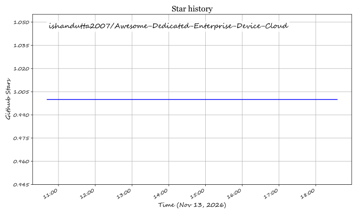

  

# 📱 Awesome Dedicated Enterprise Device Cloud ☁️ 

> 🌟 A curated directory of SaaS platforms, self-hosted device farms, and open-source infrastructure tools for **Dedicated Enterprise Device Clouds**, private mobile labs, and isolated continuous testing environments.

Dedicated Enterprise Device Clouds provide exclusive, reserved access to real mobile smartphones, tablets, and desktop browsers hosted in isolated environments. Unlike shared public device pools, dedicated device farms feature persistent device state, custom MDM (Mobile Device Management) profiles, VPN tunnels, SIM card configurations, and hardware-level isolation required for enterprise compliance, security, and mission-critical automated testing (Appium, Selenium, XCUITest, Espresso).

---

## 📑 Table of Contents
- [📊 Sector Overview & Market Dynamics](#-sector-overview--market-dynamics)
- [🏢 Enterprise SaaS & Hosted Private Clouds](#-enterprise-saas--hosted-private-clouds)
- [🛠️ Open-Source Device Farms & Orchestration](#️-open-source-device-farms--orchestration)
- [🏗️ Key Architectural Considerations](#️-key-architectural-considerations)
- [🤝 Contributing](#-contributing)
- [💖 Support & Sponsorship](#-support--sponsorship)
- [📈 Star History](#-star-history)
- [📜 License & Disclaimer](#-license--disclaimer)

---

## 📊 Sector Overview & Market Dynamics

The global mobile application testing and cloud device farm market is valued at approximately **$8 Billion to $12 Billion** and is projected to expand to **$35 Billion to $50 Billion by 2032–2034**, expanding at a robust Compound Annual Growth Rate (**CAGR of ~16% to 17.5%**). 🚀

The enterprise device cloud sector is **moderately fragmented**: hyper-scale public cloud titans (such as AWS Device Farm) provide underlying elastic compute infrastructure, while specialized QA testing leaders (such as BrowserStack, Sauce Labs, and SmartBear BitBar) capture substantial private enterprise workloads, co-existing alongside niche compliance platforms and a flourishing open-source ecosystem (e.g., DeviceFarmer STF, GADS, Appium) leveraged by engineering teams with strict on-premise data sovereignty mandates. 🌐

---

## 🏢 Enterprise SaaS & Hosted Private Clouds

The following commercial vendors deliver dedicated, isolated device infrastructure with custom enterprise security controls. Ranked and sorted in descending order by company scale (market capitalization or private valuation / estimated revenue):

| Product | 🏢 Company Size (Valuation / Revenue) | 📝 Description | 💳 Starting Pricing | 🎁 Free Tier / Trial Limits |
| :--- | :--- | :--- | :--- | :--- |
| **[AWS Device Farm Private Devices](https://aws.amazon.com/device-farm/)** | **~$2.2 Trillion Market Cap** (Amazon / AWS: $100B+ ARR) | Physical smartphones and tablets deployed in dedicated AWS data center racks exclusively for your AWS account. Supports rooted Android configurations, custom OS builds, manual debugging, and Appium/XCUITest automation suites. | Starts at **$200/month per dedicated device** (plus hardware tiering) | One-time **1,000 free device minutes** for initial testing on AWS Device Farm; private hardware instances require paid subscription. |
| **[BrowserStack Custom Device Lab](https://www.browserstack.com/custom-device-lab)** | **$4.0 Billion Valuation** (~$225M–$250M ARR) | Private device racks providing 100% reserved iOS, Android, and desktop browser environments. Offers custom MDM profile pushing, fixed SIM cards, biometric testing (Touch ID/Face ID, Apple Pay), local network VPN tunneling, and zero session data contamination. | Starts at **$29/user/month** (Standard Live); Custom Device Lab starts at **~$2,500/month** (Annual enterprise commitment) | **Free trial includes 30 minutes** of interactive Live testing and **100 minutes** of automated testing across real devices upon signup. |
| **[BitBar Private Cloud (SmartBear)](https://smartbear.com/product/bitbar/)** | **$1.8 Billion – $1.9 Billion Valuation** (~$150M+ ARR) | Dedicated physical devices and desktop environments hosted in secure SmartBear facilities or deployed directly inside customer VPCs (AWS, Azure, GCP). Provides VPN connectivity, unlimited testing minutes per reserved device, and support for any mobile automation framework. | Starts at **$39/parallel/month** (Cloud plan); Private Cloud starts at **~$2,000/month** (Dedicated annual contract) | **14-day free trial** with full platform access (no credit card required) to test real device cloud capabilities. |
| **[Digital.ai Continuous Testing](https://digital.ai/)** | **~$1.0 Billion+ Valuation** (TPG Capital Portfolio / ~$100M+ ARR) | High-compliance on-premises and private cloud device lab formerly known as Experitest SeeTest. Deploys behind corporate firewalls with hardware virtualization, support for audio streaming, performance profiling, and enterprise SSO integration. | Starts at **$1,500/month** (Base private instance licensing) | **Guided 30-day enterprise proof-of-concept (POC)** / trial provided upon sales engagement and environment architecture review. |
| **[Sauce Labs Private Cloud](https://saucelabs.com/)** | **~$750 Million – $1.0 Billion Valuation** (~$95M ARR) | Enterprise-grade private cloud hosting dedicated real mobile devices and clean virtual machine environments. Integrates continuous automated testing, network traffic virtualization, real-time error reporting, and dedicated VPN tunnels (Sauce Connect). | Starts at **$39/month** (Live Testing plan); Private Cloud starts at **~$1,800/month** (Dedicated device tiers) | **28-day free trial** including **60 minutes** of automated and live testing across real devices and emulators/simulators. |
| **[Kobiton Private Device Cloud](https://kobiton.com/platform/)** | **~$100 Million Valuation** (~$28M ARR) | Private cloud and hybrid on-premises device management platform. Supports customer-owned physical devices plugged into local macOS/Linux hosts, AI-driven scriptless automation, Appium generation, and biometric validation. | Starts at **$83/month** (Startup plan with 500 min/mo); Private/On-Prem starts at **~$1,200/month** | **14-day free trial** offering up to **120 real device testing minutes** and full access to explore the Kobiton portal. |
| **[TestGrid Private Cloud](https://testgrid.io/)** | **~$20 Million – $30 Million Valuation** (~$5M ARR) | Turnkey dedicated real device cloud deployable on dedicated cloud infrastructure or on-premise hardware appliances. Provides SOC 2, HIPAA, and GDPR compliance, local USB hub integrations, IoT testing, and no-code script generation. | Starts at **$199/month** (Team tier); Dedicated Private Cloud starts at **~$999/month** | **7-day free trial** with **200 minutes** of real mobile and browser testing time upon corporate email registration. |
| **[Genymotion Cloud](https://www.genymotion.com/)** | **~$15 Million – $25 Million Valuation** (~$8M ARR) | High-performance Android virtual device infrastructure (SaaS, PaaS, and AWS/GCP/Alibaba Cloud AMIs). Capable of scaling thousands of Android virtual instances with hardware GPU acceleration, ADB shell access, and CI/CD orchestration. | Starts at **$0.05/minute** (Pay-as-you-go) or **$240/user/year** (SaaS plan) | **1,000 free minutes (or $50 in cloud usage credits)** provided for SaaS trial; **Free forever** desktop personal edition for non-commercial local use. |

---

## 🛠️ Open-Source Device Farms & Orchestration

For engineering teams seeking complete data sovereignty, zero recurring cloud license fees, and the ability to build self-hosted device walls, these open-source tools offer device control, screen streaming, and grid orchestration. ⚡

Sorted in descending order by GitHub stargazers count:

| Repository | ⭐ GitHub_Stars | 💻 Primary Language | 🏗️ Architecture & Description |
| :--- | :---: | :---: | :--- |
| **[Genymobile/scrcpy](https://github.com/Genymobile/scrcpy)** |  | C / Java | Foundational low-latency Android screen mirroring and remote control over USB/TCP-IP. Powers remote frame grabbing in numerous private device cloud architectures. |
| **[appium/appium](https://github.com/appium/appium)** |  | TypeScript / JS | The industry-standard open-source automation framework for cross-platform native, hybrid, and mobile web testing on iOS, Android, and Windows. |
| **[openstf/stf](https://github.com/openstf/stf)** *(Archived)* |  | JavaScript / Go | The pioneer open-source Smartphone Test Farm. Enables remote browser-based interaction, debugging, and inventory management for fleets of Android devices. |
| **[SeleniumHQ/docker-selenium](https://github.com/SeleniumHQ/docker-selenium)** |  | Shell / Dockerfile | Containerized Selenium Grid infrastructure with Chrome, Firefox, and Edge nodes for running automated browser testing at scale on enterprise hardware. |
| **[DeviceFarmer/stf](https://github.com/DeviceFarmer/stf)** |  | JavaScript / Node.js | The community-driven, active successor to OpenSTF. Features real-time screen streaming via minicap, ADB terminal control, and multi-device browser management. |
| **[aerokube/selenoid](https://github.com/aerokube/selenoid)** |  | Go | Blazing-fast, lightweight alternative to Selenium Grid. Runs browsers inside isolated Docker containers on-demand with VNC video streaming and automated cleanup. |
| **[NetrisTV/ws-scrcpy](https://github.com/NetrisTV/ws-scrcpy)** |  | TypeScript | High-performance Web client and WebSocket proxy for scrcpy. Enables browser-based video streaming and touch interaction for Android devices in custom farms. |
| **[SonicCloudOrg/sonic-server](https://github.com/SonicCloudOrg/sonic-server)** |  | Java / Vue | Cloud-based real-device platform for Android, iOS, and HarmonyOS. Provides unified distributed agent management, remote web control, and automated test runs. |
| **[openatx/atxserver2](https://github.com/openatx/atxserver2)** |  | Python / Vue | Python-based smartphone device farm supporting Android and iOS. Features QR-code provisioning, WebRTC screen casting, and Python automation hooks. |
| **[shamanec/GADS](https://github.com/shamanec/GADS)** |  | Go / React | Dual-licensed modern device farm for iOS, Android, and Smart TVs. Features Appium grid routing, WebRTC streaming, JWT authentication, and device reservation. |
| **[aerokube/moon](https://github.com/aerokube/moon)** |  | Go | Kubernetes-native test execution platform for browsers and mobile emulators, enabling dynamic autoscaling and enterprise cluster isolation. |
| **[zebrunner/mcloud](https://github.com/zebrunner/mcloud)** |  | Shell / Python | Mobile device farm wrapper providing Appium node orchestration, device allocation, and containerized mobile test execution across physical devices. |

---

## 🏗️ Key Architectural Considerations

When architecting an enterprise-grade dedicated device cloud (or deciding between SaaS vs. self-hosted), evaluate these core technical vectors:

1. 🔌 **Host-to-Device Physical Topology**: Real devices require industrial USB hubs (Cambrionix, Tripp Lite) with per-port power cycling to prevent battery bloating and disconnect dropouts.
2. 🛡️ **Network Isolation & MDM Profiles**: Enterprise compliance requires dedicated subnetting, VPN tunnels (IPsec/WireGuard), and MDM profiles to inject client certificates, configure corporate proxies, and manage entitlements.
3. 🔄 **Automated State Teardown**: After test sessions finish, ensure automated reset routines execute: uninstall test APKs/IPAs, clear application data, reset system permissions, and revoke device credentials.
4. 🍏 **iOS vs. Android Complexity**: While Android can be orchestrated across Linux hosts using ADB, iOS devices mandate macOS host machines with Xcode developer provisioning profiles, WDA (WebDriverAgent), and Apple Developer Enterprise accounts.

---

## 🤝 Contributing

Contributions, updates, and corrections are warmly welcomed! 🌟

1. Fork this repository.
2. Add your suggested SaaS product or open-source repository following the table format.
3. Verify that all URLs, pricing tiers, and GitHub links are accurate.
4. Open a Pull Request with a clear description of the addition.

---

## 💖 Support & Sponsorship

Thank you so much for using and exploring **Awesome Dedicated Enterprise Device Cloud**! If you find this curated collection helpful for your testing pipelines, enterprise infrastructure, or team research, please consider supporting the project:

- ⭐ **Star this repository** to help others discover it.
- 🍴 **Fork and share** it with fellow QA engineers and platform teams.
- ☕ **Buy me a coffee / Sponsor the project**: Contributions directly fuel continuous maintenance and research! You can sponsor via the [GitHub Sponsors Dashboard](https://github.com/sponsors/ishandutta2007).

---

## 📈 Star History

---

## 📜 License & Disclaimer

- 📄 Licensed under the [MIT License](LICENSE).
- ⚖️ *Disclaimer*: All product names, logos, trademarks, and registered trademarks belong to their respective owners. Mention of SaaS providers and open-source projects is for informational and educational purposes only and does not constitute formal endorsement.

## ⭐ Star History

<a href="https://star-history.com/#ishandutta2007/Awesome-Dedicated-Enterprise-Device-Cloud&Timeline" align="center">
  <picture>
    <source media="(prefers-color-scheme: dark)" srcset="assets/ishandutta2007_Awesome-Dedicated-Enterprise-Device-Cloud_growth.svg">
    
  </picture>
</a>
